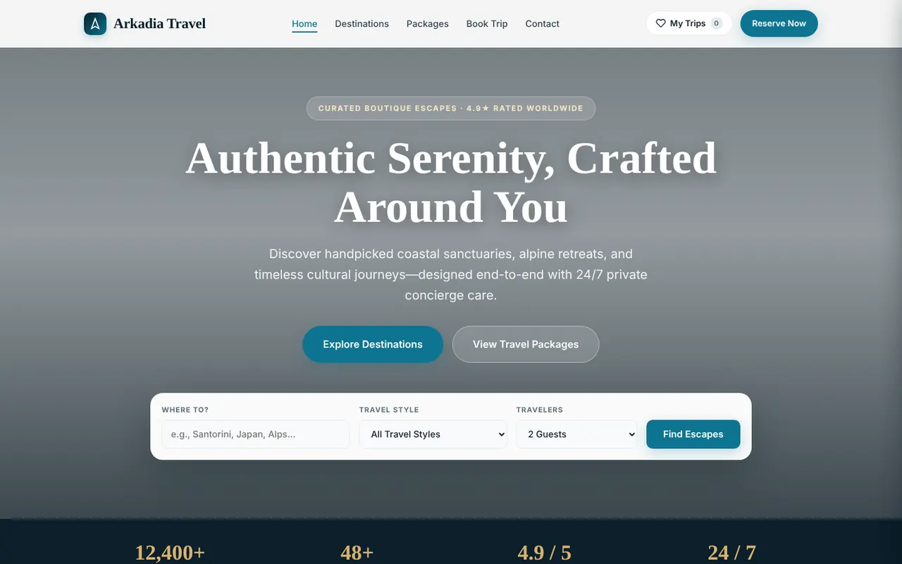

# Arkadia Travel

Boutique luxury travel agency website — destination explorer, package filters and a multi-step booking flow.

**Live demo:** https://arkadia-travel-2026.surge.sh



## Features

- Destination explorer with detail modals and wishlist
- Travel packages with filters
- Multi-step booking with live price totals and promo codes
- “My Trips” drawer and printable booking receipts
- FAQ, contact form, legal modals and a custom 404 page

## Tech stack

HTML5 · CSS3 · Vanilla JavaScript

## Run it locally

No build step — open `index.html` in a browser, or serve the folder:

```bash
npx serve .
```

---

Built by [Seif Sarhan](https://seifsarhan.github.io) · [GitHub](https://github.com/seifsarhan)
